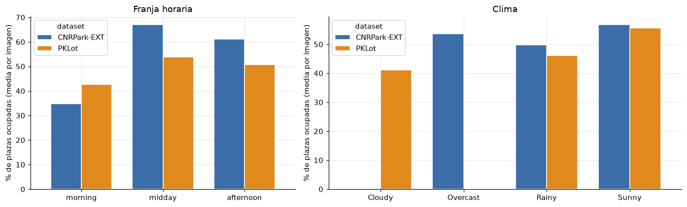
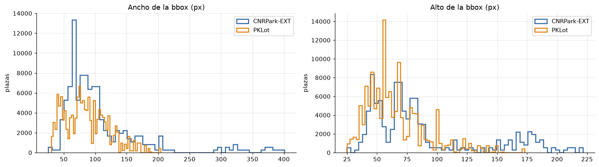
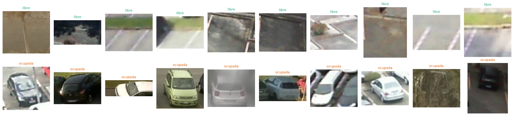
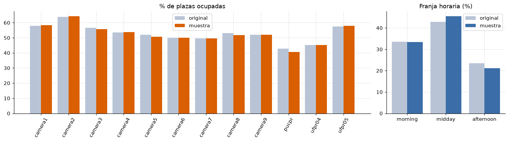

# Meta-PKLot-mini

Subconjunto reducido de [MetaPKLot](https://huggingface.co/datasets/DSBD-Research/MetaPKLot-Dataset), preparado para detectar plazas de aparcamiento libres y ocupadas. Son 5 000 imágenes de dos datasets (PKLot y CNRPark-EXT) con 239 257 plazas anotadas, en formato COCO.


*Verde: plaza libre. Naranja: plaza ocupada. Línea discontinua: plaza truncada por el recorte.*

## Origen

[MetaPKLot](https://huggingface.co/datasets/DSBD-Research/MetaPKLot-Dataset) unifica y reanota tres datasets de aparcamientos: PKLot, CNRPark-EXT y PLds. Aquí solo se usan las anotaciones de plazas (`original/spots`) de PKLot y CNRPark-EXT.

## Contenido

| Propiedad         | Valor                                                             |
| ----------------- | ----------------------------------------------------------------- |
| Imágenes          | 5 000 (2 500 de PKLot y 2 500 de CNRPark-EXT)                     |
| Plazas anotadas   | 239 257 (119 934 libres y 119 323 ocupadas)                       |
| Plazas truncadas  | 2 220 (el recorte corta la plaza y se conserva ≥ 50 % de su área) |
| Subsets de origen | 12 (3 aparcamientos de PKLot y 9 cámaras de CNRPark-EXT)          |
| Días distintos    | 123, de 2012-09-11 a 2016-02-12                                   |
| Climas            | Cloudy, Overcast, Rainy y Sunny                                   |


| Dataset     | Subset  | Imágenes | Días | Plazas libres | Plazas ocupadas | Tamaño de imagen |
| ----------- | ------- | -------: | ---: | ------------: | --------------: | ---------------- |
| PKLot       | pucpr   |      235 |   37 |        27 242 |          18 583 | 1280×580         |
| PKLot       | ufpr04  |    1 268 |   30 |        25 125 |          20 771 | 1280×720         |
| PKLot       | ufpr05  |      997 |   33 |        19 302 |          26 560 | 1280×720         |
| CNRPark-EXT | camera1 |      278 |   23 |         4 054 |           5 676 | 922×592          |
| CNRPark-EXT | camera2 |      278 |   23 |           993 |           1 787 | 1000×750         |
| CNRPark-EXT | camera3 |      278 |   23 |         2 827 |           3 567 | 1000×750         |
| CNRPark-EXT | camera4 |      278 |   23 |         5 535 |           6 419 | 1000×750         |
| CNRPark-EXT | camera5 |      278 |   23 |         7 529 |           7 761 | 1000×750         |
| CNRPark-EXT | camera6 |      278 |   23 |         7 646 |           7 644 | 1000×750         |
| CNRPark-EXT | camera7 |      278 |   23 |         7 404 |           7 330 | 1000×750         |
| CNRPark-EXT | camera8 |      278 |   23 |         7 371 |           7 919 | 1000×750         |
| CNRPark-EXT | camera9 |      276 |   23 |         4 906 |           5 306 | 825×750          |

### Estructura

```text
Meta-PKLot-mini/
├── annotations.json   # COCO único con las 5 000 imágenes
├── images/            # 00001.jpg ... 05000.jpg (nombre = id COCO de la imagen)
├── assets/            # figuras de este README
└── tools/             # notebook que genera el dataset
```

### Formato de las anotaciones

JSON tipo COCO con un esquema propio. Subset, clima y franja horaria son listas de consulta y cada imagen guarda solo el id. Todos los ids empiezan en 1.

```json
{
  "info": {},
  "licenses": [],
  "categories": [{"id": 1, "name": "empty"}, {"id": 2, "name": "occupied"}],
  "climates": [{"id": 1, "name": "Cloudy"}, {"id": 2, "name": "Overcast"},
               {"id": 3, "name": "Rainy"}, {"id": 4, "name": "Sunny"}],
  "times_of_day": [{"id": 1, "name": "morning"}, {"id": 2, "name": "midday"},
                   {"id": 3, "name": "afternoon"}],
  "datasets": [
    {"id": 1, "name": "PKLot", "subsets": [{"id": 1, "name": "pucpr"}, ...]},
    {"id": 2, "name": "CNRPark-EXT", "subsets": [{"id": 4, "name": "camera1"}, ...]}
  ],
  "images": [],
  "annotations": []
}
```

Cada imagen (`images`):

```json
{
  "id": 1,
  "file_name": "images/00001.jpg",
  "width": 1280, "height": 580,
  "subset_id": 1,
  "date": "2012-11-20", "hour": 14,
  "time_of_day_id": 2,
  "climate_id": 4,
  "empty_spots": 72, "occupied_spots": 123,
  "original": {
    "id": 11000000023,
    "file_name": "PKLot/PUCPR/Sunny/2012-11-20/2012-11-20_14_39_41.jpg",
    "crop": [0, 140, 1280, 580]
  }
}
```

- `file_name`: ruta relativa a la raíz del dataset.
- `subset_id`: el dataset se obtiene de `datasets`.
- `time_of_day_id`: `morning` hasta las 10 h, `midday` hasta las 15 h y `afternoon` el resto.
- `original`: imagen de MetaPKLot de la que sale. `crop = [x, y, w, h]` es el `annotationsRectangle` aplicado, en coordenadas de la imagen completa.

Cada anotación (`annotations`):

```json
{
  "id": 1,
  "image_id": 1,
  "category_id": 2,
  "segmentation": [[88.0, 53.0, 102.0, 27.0, 88.0, 27.0, 72.0, 49.0]],
  "bbox": [72.0, 27.0, 30.0, 26.0],
  "area": 390.0,
  "iscrowd": 0,
  "truncated": 0
}
```

- `segmentation`: polígono de la plaza, en coordenadas del recorte.
- `bbox`: `[x, y, ancho, alto]`, con `(x, y)` en la esquina superior izquierda.
- `iscrowd`: siempre 0.
- `truncated`: 1 si el recorte cortó la plaza.

## Análisis

### Balance de clases

Las dos clases quedan equilibradas en casi todos los subsets.


### Ocupación según franja horaria y clima

Se recogen ocupaciones distintas a lo largo del día y con distinto clima.



### Imágenes por subset, franja y clima

Las casillas a 0 indican condiciones que el modelo no verá en ese subset. Por ejemplo, CNRPark-EXT no tiene `Cloudy` y PKLot no tiene `Overcast`.


### Tamaño de las plazas

Ancho y alto de la `bbox` en píxeles.



### Recortes de plazas

Plazas recortadas por su `bbox`.



## Procesamiento aplicado

1. **Filtrado.** Se quita PLds (sin imágenes) y las imágenes sin plazas anotadas.
2. **Reparto.** 2 500 imágenes de cada dataset. En CNRPark-EXT, unas 278 por cámara. En PKLot el reparto iguala las plazas que aporta cada subset (235 imágenes de `pucpr`, 1 268 de `ufpr04` y 997 de `ufpr05`), porque `pucpr` tiene 195 plazas por imagen frente a unas 36 y 46.
3. **Muestreo estratificado.** Dentro de cada subset se toma la misma fracción de cada combinación de día, franja horaria y clima, con `random_state=99`. La muestra conserva la proporción de plazas ocupadas y el reparto por franja del original.

   

4. **Recorte.** Cada imagen se recorta a su `annotationsRectangle`: fuera de esa región hay plazas sin anotar que el detector aprendería como fondo.
5. **Normalización de las anotaciones.**
   - Las coordenadas se desplazan al origen del recorte.
   - El polígono se recorta al borde (Sutherland–Hodgman) y la plaza se marca `truncated = 1`. Si queda menos del 50 % de su área, se descarta.
   - `bbox` y `area` se recalculan desde el polígono, con float de 2 decimales. En el original PKLot usa enteros y CNRPark-EXT decimales.
   - Las categorías pasan a 1-based y los ids a secuenciales. El id de MetaPKLot de cada imagen se conserva en `original.id`.
   - Se descartan `car_id`, `best_rotated_rect` y el id original de cada plaza.

El código está en `tools/PIC_Proyecto_Dataset_Mini.ipynb`.

## Uso

```python
import json
from huggingface_hub import snapshot_download

path = snapshot_download(
    repo_id='StafLoker/Meta-PKLot-mini',
    repo_type='dataset',
    local_dir='Meta-PKLot-mini',
)
coco = json.load(open(f'{path}/annotations.json'))
```

## Licencia

Meta-PKLot-mini mezcla recursos con condiciones distintas, por lo que usa `license: other`:

- **PKLot:** Creative Commons Attribution 4.0 International (CC BY 4.0).
- **CNRPark-EXT:** Open Data Commons Open Database License (ODbL) v1.0.

Consulta las condiciones de cada dataset original antes de reutilizar las imágenes. El `subset_id` de cada imagen indica a qué dataset pertenece.

## Autores

Anthony Manzueta Difo, Stefan Oshchypok, Marina Ruiz Izu.
