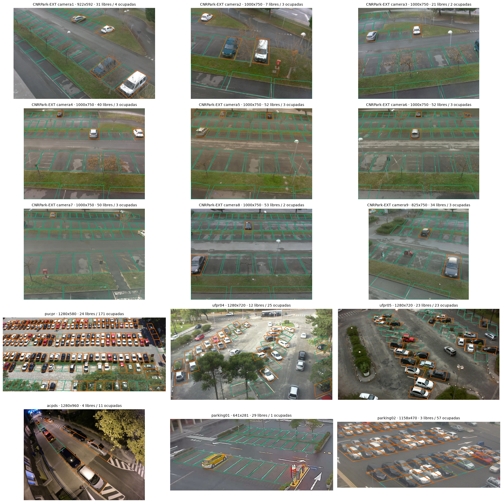
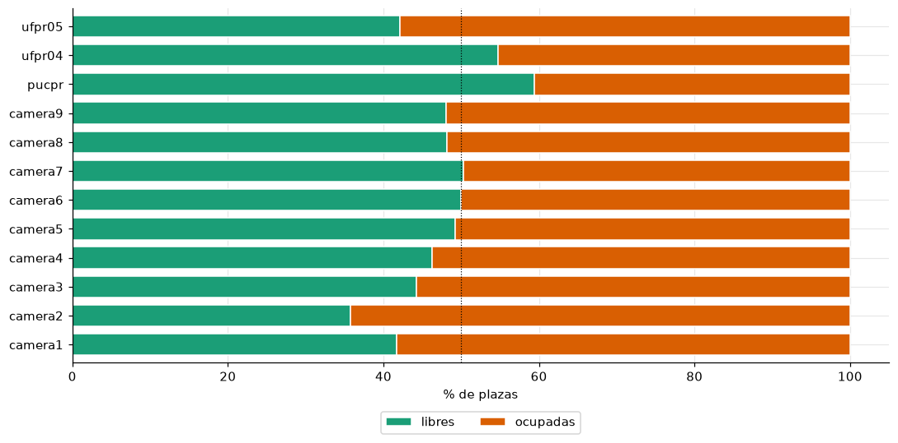
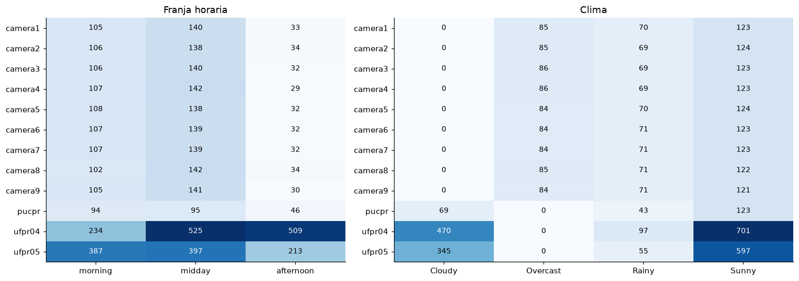
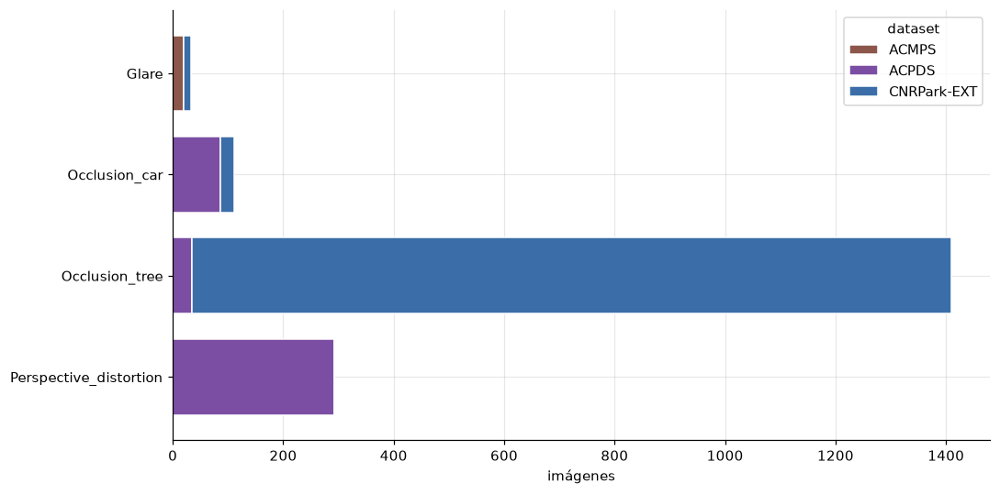

# Meta-PKLot-mini

Subconjunto reducido y ampliado de [MetaPKLot](https://huggingface.co/datasets/DSBD-Research/MetaPKLot-Dataset), preparado para detectar plazas de aparcamiento libres y ocupadas. Son 4 993 imágenes de cuatro datasets (PKLot, CNRPark-EXT, ACPDS y ACMPS) con 259 568 plazas anotadas, en formato COCO. Versión 2.0.



*Verde: plaza libre. Naranja: plaza ocupada. Línea discontinua: plaza truncada por el recorte.*

## Origen

| Dataset     | Qué aporta                                        | Licencia   | Fuente                                                                       |
| ----------- | ------------------------------------------------- | ---------- | ---------------------------------------------------------------------------- |
| PKLot       | 3 aparcamientos con cámara fija                   | CC BY 4.0  | [MetaPKLot](https://huggingface.co/datasets/DSBD-Research/MetaPKLot-Dataset) |
| CNRPark-EXT | 9 cámaras en un mismo aparcamiento                | ODbL v1.0  | [MetaPKLot](https://huggingface.co/datasets/DSBD-Research/MetaPKLot-Dataset) |
| ACPDS       | 293 fotos de un aparcamiento hechas con una GoPro | MIT        | [Eighonet/parking-research](https://github.com/Eighonet/parking-research)    |
| ACMPS       | 2 aparcamientos, fotos de 1280×800 y 1280×736     | No se sabe | [Eighonet/parking-research](https://github.com/Eighonet/parking-research)    |

[MetaPKLot](https://huggingface.co/datasets/DSBD-Research/MetaPKLot-Dataset) unifica y reanota PKLot, CNRPark-EXT y PLds. Aquí solo se usan las anotaciones de plazas (`original/spots`) de PKLot y CNRPark-EXT. ACPDS y ACMPS son las versiones procesadas del repositorio [Eighonet/parking-research](https://github.com/Eighonet/parking-research). Ese mismo repositorio aporta las etiquetas de escena de CNRPark-EXT (`Glare`, `Occlusion_car`, `Occlusion_tree` y `Fog`).

Referencias:

- Marek (2021). *Image-Based Parking Space Occupancy Classification: Dataset and Baseline*. [arXiv:2107.12207](https://arxiv.org/abs/2107.12207). Origen de ACPDS.
- Martynova et al. (2023). *Revising deep learning methods in parking lot occupancy detection*. [arXiv:2306.04288](https://arxiv.org/abs/2306.04288). Reúne ACPDS, ACMPS, PKLot, CNRPark y SPKL.

## Contenido

| Propiedad         | Valor                                                                                  |
| ----------------- | -------------------------------------------------------------------------------------- |
| Imágenes          | 4 993 (1 600 de PKLot, 1 800 de CNRPark-EXT, 293 de ACPDS y 1 300 de ACMPS)            |
| Plazas anotadas   | 259 568 (121 009 libres y 138 559 ocupadas)                                            |
| Plazas truncadas  | 8 100 (el recorte corta la plaza y se conserva ≥ 50 % de su área)                      |
| Plazas con cruz   | 221 (X pintada en el suelo, solo en ACPDS)                                             |
| Subsets de origen | 15 (3 de PKLot, 9 cámaras de CNRPark-EXT, 1 de ACPDS y 2 de ACMPS)                     |
| Días distintos    | 123, de 2012-09-11 a 2016-02-12 (ACPDS y ACMPS no tienen fecha)                        |
| Climas            | Overcast (1 529), Rainy (825), Sunny (2 070) y Fog (50); 519 imágenes sin clima        |
| Franjas horarias  | morning (1 199), midday (1 503), afternoon (651) y night (87); 1 553 sin franja        |
| Condiciones       | Occlusion_tree (1 409), Perspective_distortion (293), Occlusion_car (111) y Glare (33) |

| Dataset     | Subset    | Imágenes | Días | Plazas libres | Plazas ocupadas | Tamaño de imagen |
| ----------- | --------- | -------: | ---: | ------------: | --------------: | ---------------- |
| PKLot       | pucpr     |      300 |   37 |        32 375 |          26 125 | 1280×580         |
| PKLot       | ufpr04    |      730 |   30 |        14 488 |          11 934 | 1280×720         |
| PKLot       | ufpr05    |      570 |   33 |        11 322 |          14 898 | 1280×720         |
| CNRPark-EXT | camera1   |      200 |   23 |         3 136 |           3 864 | 922×592          |
| CNRPark-EXT | camera2   |      200 |   23 |           776 |           1 224 | 1000×750         |
| CNRPark-EXT | camera3   |      200 |   23 |         2 067 |           2 533 | 1000×750         |
| CNRPark-EXT | camera4   |      200 |   23 |         4 104 |           4 496 | 1000×750         |
| CNRPark-EXT | camera5   |      200 |   23 |         5 471 |           5 529 | 1000×750         |
| CNRPark-EXT | camera6   |      200 |   23 |         5 740 |           5 260 | 1000×750         |
| CNRPark-EXT | camera7   |      200 |   23 |         5 591 |           5 009 | 1000×750         |
| CNRPark-EXT | camera8   |      200 |   23 |         5 231 |           5 769 | 1000×750         |
| CNRPark-EXT | camera9   |      200 |   23 |         3 684 |           3 716 | 825×750          |
| ACPDS       | acpds     |      293 |    – |         5 860 |           5 376 | 1280×960         |
| ACMPS       | parking01 |      650 |    – |         4 214 |          15 286 | 641×281          |
| ACMPS       | parking02 |      650 |    – |        16 950 |          27 540 | 1158×470         |

El tamaño es el de la imagen ya recortada: cada subset tiene un único tamaño.

### Estructura

```text
Meta-PKLot-mini/
├── annotations.json   # COCO único con las 4 993 imágenes
├── images/            # 00001.jpg ... 04993.jpg (nombre = id COCO de la imagen)
├── assets/            # figuras de este README
└── tools/             # librería de lectura, adaptador de PyTorch y notebook que genera el dataset
```

### Formato de las anotaciones

JSON tipo COCO con un esquema propio. Dataset, subset, clima, franja horaria, condiciones y tipo de plaza son listas de consulta, y cada imagen o plaza guarda solo el id. Todos los ids empiezan en 1.

```json
{
  "info": {},          // descripción, versión (2.0) y origen
  "licenses": [],      // CC BY 4.0, ODbL v1.0, MIT, not stated
  "categories": [],    // 1 = empty, 2 = occupied
  "climates": [],      // 1 Overcast, 2 Rainy, 3 Sunny, 4 Fog (el Cloudy de PKLot es Overcast)
  "times_of_day": [],  // 1 morning, 2 midday, 3 afternoon, 4 night
  "conditions": [],    // 1 Glare, 2 Occlusion_car, 3 Occlusion_tree, 4 Perspective_distortion
  "spot_types": [],    // 1 normal, 2 cross (X pintada en el suelo)
  "datasets": [],      // PKLot, CNRPark-EXT, ACPDS y ACMPS, con licencia y enlaces
  "subsets": [],       // parking y número de cámara
  "images": [],
  "annotations": []
}
```

Listas de consulta. `images[].subset_id` apunta a `subsets`, `subsets[].dataset_id` a `datasets` y `datasets[].license_id` a `licenses`:

```json
"datasets": [
  {"id": 1, "name": "PKLot", "license_id": 1,
   "url": "https://web.inf.ufpr.br/vri/databases/parking-lot-database/",
   "download_url": "https://huggingface.co/datasets/DSBD-Research/MetaPKLot-Dataset"},
  ...
],
"subsets": [
  {"id": 1, "dataset_id": 1, "parking": "pucpr", "camera": 1},
  {"id": 4, "dataset_id": 2, "parking": "CNRPark-EXT", "camera": 1},
  {"id": 14, "dataset_id": 4, "parking": "parking01", "camera": 1}
]
```

Cada imagen (`images`):

```json
{
  "id": 1,
  "file_name": "images/00001.jpg",
  "width": 922, "height": 592,
  "subset_id": 4,
  "date": "2015-12-19", "hour": 9,
  "time_of_day_id": 1,
  "climate_id": 1,
  "condition_ids": [3],
  "original": {
    "id": 21000000001,
    "file_name": "CNRPark-EXT/camera1/OVERCAST/2015-12-19/2015-12-19_09_18_00.jpg",
    "crop": [78, 158, 922, 592]
  }
}
```

- `file_name`: ruta relativa a la raíz del dataset.
- `subset_id`: el dataset se obtiene de `subsets[].dataset_id`.
- `date`, `hour`: `null` en ACPDS y ACMPS.
- `time_of_day_id`: `morning` de 6 a 10 h, `midday` de 11 a 15 h, `afternoon` de 16 a 19 h y `night` de 20 a 5 h. En ACPDS y ACMPS no hay hora: solo es `night` si la foto lleva esa etiqueta, y el resto es `null`.
- `climate_id`: `null` si la foto de ACPDS o ACMPS no trae clima.
- `condition_ids`: etiquetas de escena. Vacío en PKLot.
- `original`: de dónde sale la imagen. `id` es el de MetaPKLot (`null` en ACPDS y ACMPS). `crop = [x, y, w, h]` es el recorte aplicado, en coordenadas de la imagen original, y es `null` en ACPDS, que no se recorta.

Cada anotación (`annotations`):

```json
{
  "id": 1,
  "image_id": 1,
  "category_id": 1,
  "segmentation": [[313.4, 170.6, 357.0, 199.4, 269.0, 261.5, 218.0, 234.4]],
  "bbox": [218.0, 170.6, 139.0, 90.9],
  "area": 5540.55,
  "truncated": 0,
  "spot_type_id": 1
}
```

- `segmentation`: polígono de la plaza, en coordenadas del recorte.
- `bbox`: `[x, y, ancho, alto]`, con `(x, y)` en la esquina superior izquierda.
- `area`: área del polígono.
- `truncated`: 1 si el recorte cortó la plaza.
- `spot_type_id`: `2` (`cross`) para las plazas con una X pintada en el suelo.

## Análisis

### Balance de clases

Hay un 47 % de plazas libres y un 53 % de ocupadas. Salvo `parking01` de ACMPS, con un 78 % de plazas ocupadas, todos los subsets tienen entre un 45 % y un 62 % de ocupadas.



### Ocupación según franja horaria y clima

Se recogen ocupaciones distintas a lo largo del día y con distinto clima. En CNRPark-EXT sube de un 35 % por la mañana a un 65 % al mediodía, y en PKLot de un 44 % a un 53 %. `sin etiqueta` agrupa las imágenes sin franja horaria o sin clima (ACPDS y ACMPS).


### Imágenes por subset, franja y clima

Las casillas a 0 indican condiciones que el modelo no verá en ese subset. Por ejemplo, PKLot no tiene `Fog` y CNRPark-EXT no tiene `night`. ACPDS y ACMPS no tienen hora, así que sus imágenes caen en `sin etiqueta` salvo las de noche.



### Condiciones

Imágenes con cada etiqueta de escena, por dataset. Una imagen puede tener varias. El clima (con `Fog`) está en `climate_id` y la noche en `time_of_day_id`, no aquí.



### Tamaño de las plazas

Ancho y alto de la `bbox` en píxeles. La mediana va de 71×57 en PKLot a 125×52 en ACMPS, y ACPDS tiene la mayor dispersión (ancho del percentil 5 al 95 entre 41 y 281 px).


### Recortes de plazas

Plazas recortadas por su `bbox`.


## Procesamiento aplicado

1. **Filtrado.** Se quita PLds (sin imágenes) y las imágenes sin plazas anotadas.
2. **Reparto.**
   - CNRPark-EXT: 200 imágenes por cámara (1 800).
   - PKLot: 300 de `pucpr`, 730 de `ufpr04` y 570 de `ufpr05` (1 600), porque `pucpr` tiene 195 plazas por imagen frente a unas 36 y 46.
   - ACPDS: las 293 fotos.
   - ACMPS: 650 de cada aparcamiento (1 300 de 13 101).
3. **Muestreo estratificado.** En PKLot y CNRPark-EXT se toma, dentro de cada subset, la misma fracción de cada combinación de día, franja horaria y clima, con `random_state=99`. La muestra conserva la proporción de plazas ocupadas y el reparto por franja del original. ACMPS no tiene fecha ni hora. Se toman casi enteras las etiquetas de clima escasas, el resto son fotos sin etiqueta, y dentro de cada grupo se reparte la muestra entre los días de la marca de tiempo del zip, para no coger fotos casi iguales.
4. **Etiquetas de escena.**
   - CNRPark-EXT: `Glare`, `Occlusion_car` y `Occlusion_tree` pasan a `condition_ids`, y `Fog` a `climate_id`. Las etiquetas se emparejan con las imágenes por el contenido del fichero (SHA-1), porque sus nombres se repiten entre cámaras. Se ignoran `Night` y las etiquetas de clima del zip.
   - ACPDS y ACMPS: clima y escena salen de sus ficheros de etiquetas. Las 4 fotos `Infrared` de ACMPS no se usan.
   - ACPDS: las plazas con una X pintada se marcaron a mano y pasan al tipo `cross`.
5. **Recorte.** Cada imagen se recorta a una región con plazas anotadas, porque fuera hay plazas sin anotar que el detector aprendería como fondo.
   - MetaPKLot: su `annotationsRectangle`.
   - ACMPS: un rectángulo por aparcamiento, dibujado a mano y común a todas sus fotos.
   - ACPDS: no se recorta. Sus fotos se reducen a 1280 px de lado mayor.
6. **Normalización de las anotaciones.**
   - Las coordenadas se desplazan al origen del recorte.
   - El polígono se recorta al borde (Sutherland–Hodgman) y la plaza se marca `truncated = 1`. Si queda menos del 50 % de su área, se descarta.
   - `bbox` y `area` se recalculan desde el polígono, con float de 2 decimales.
   - Las categorías pasan a 1-based (el 0 queda para el fondo, como esperan torchvision y Faster R-CNN) y los ids a secuenciales.
   - Se descartan `car_id`, `best_rotated_rect` y el id original de cada plaza.

El notebook que genera el dataset es `tools/PIC_Proyecto_Dataset_Mini.ipynb`.

## Uso

### Con la librería de `tools/`

`meta_pklot_mini.py` lee y valida el dataset (solo usa la biblioteca estándar y Pillow). `meta_pklot_mini_torch.py` lo adapta a PyTorch.

```python
import sys
from huggingface_hub import snapshot_download

path = snapshot_download(
    repo_id='StafLoker/Meta-PKLot-mini',
    repo_type='dataset',
    local_dir='Meta-PKLot-mini',
)
sys.path.insert(0, f'{path}/tools')

from meta_pklot_mini import MetaPKLotMini, split_photos

ds = MetaPKLotMini(path)                          # valida el JSON y las imágenes al cargar
photos = ds.photos(dataset='PKLot', climate='Sunny')
photo = ds.photo(1)                               # por id COCO
photo.image(), photo.spots                        # imagen PIL y plazas (label, bbox, polygon...)

train, test = split_photos(ds, test_size=0.2)     # sin fuga: las fotos de un mismo día van juntas
```

```python
from torch.utils.data import DataLoader
from torchvision.transforms import v2
from meta_pklot_mini_torch import DetectionDataset, SpotDataset, detection_collate

# detección (Faster R-CNN...): num_classes = len(DetectionDataset.classes) = 3
DataLoader(DetectionDataset(train), batch_size=4, collate_fn=detection_collate)

# clasificación de plazas recortadas: 0 = empty, 1 = occupied
spots = SpotDataset(train, transform=v2.Resize((64, 64)))
DataLoader(spots, batch_size=64, shuffle=True)    # spots.targets sirve para un sampler
```

Si `annotations.json` está mal formado, la carga lanza `SchemaError`, `IntegrityError`, `GeometryError` o `ImageFileError` con la lista de problemas.

### Solo el JSON

```python
import json

coco = json.load(open(f'{path}/annotations.json'))
```

## Licencia

Meta-PKLot-mini mezcla recursos con condiciones distintas, por lo que usa `license: other`:

- **PKLot:** Creative Commons Attribution 4.0 International (CC BY 4.0).
- **CNRPark-EXT:** Open Data Commons Open Database License (ODbL) v1.0.
- **ACPDS:** MIT.
- **ACMPS:** no se sabe la licencia de los datos.

Consulta las condiciones de cada dataset original antes de reutilizar las imágenes. El `subset_id` de cada imagen indica a qué dataset pertenece y `datasets[].license_id`, su licencia.

## Autores

Anthony Manzueta Difo, Stefan Oshchypok, Marina Ruiz Izu.
